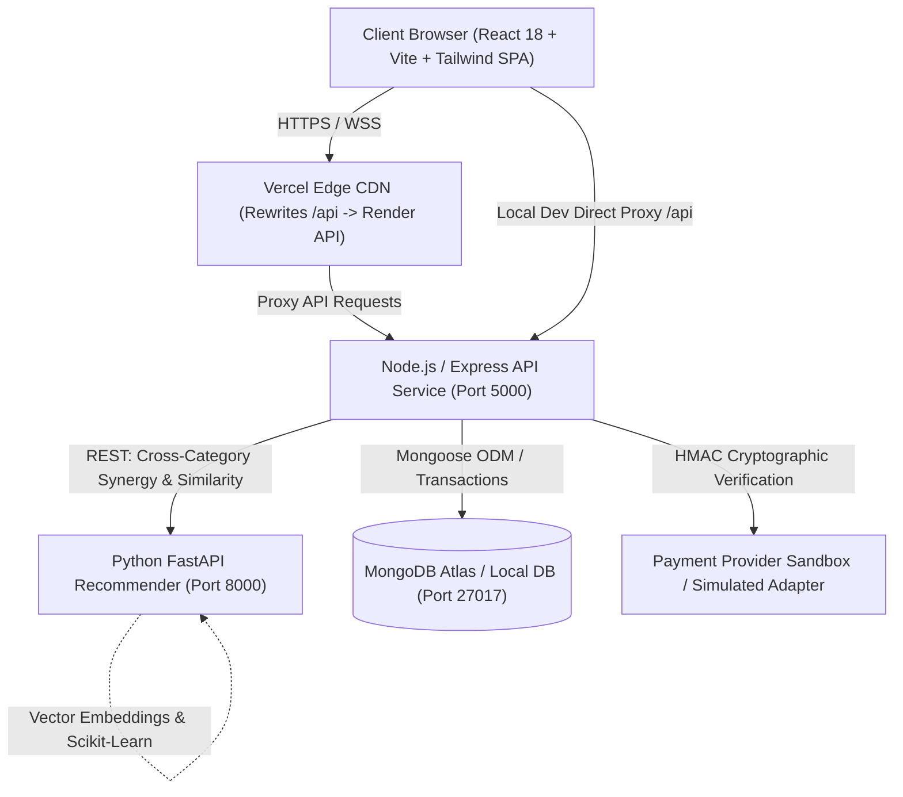
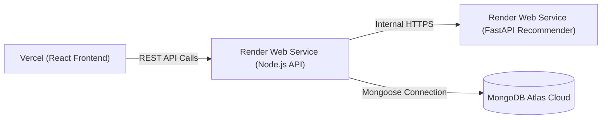

# FORMALS FOR US — SARTORIAL EXCELLENCE

> **Modern, sophisticated, accessible formalwear for professionals, office workers, interviews, meetings, and special occasions.**

[](./backend)
[](./python-service)
[](./frontend)
[](./e2e)

---

## 1. Project Overview & Architectural Blueprint

**FORMALS FOR US** is a full-stack, enterprise-grade formal clothing e-commerce platform built for the Indian market. It features authoritative server-side price/stock calculations, atomic inventory management, a dedicated Python recommendation engine, guest-to-member cart synchronization, simulated cryptographic payment verification, an administrative analytics and catalog console, and responsive mobile optimization.

### Microservices & Data Flow Architecture



---

## 2. Technology Stack

| Layer | Technologies & Libraries |
| :--- | :--- |
| **Frontend** | React 18, Vite 6, TypeScript, Tailwind CSS, React Router v6, Lucide Icons, Axios, Recharts (Admin Visualizations), Vitest, React Testing Library |
| **Backend API** | Node.js (v20+), Express, TypeScript, MongoDB, Mongoose 8, JWT (JSON Web Tokens), bcryptjs, Zod 3, Helmet, CORS, Express-Rate-Limit, Morgan |
| **Recommendation Engine** | Python 3.11+, FastAPI, Pydantic v2, Uvicorn, Scikit-learn (TF-IDF & Cosine Similarity), pytest |
| **Testing & Quality Assurance** | Vitest (API & UI unit tests), Supertest (HTTP integration), pytest (Python microservice), Playwright (Multi-device End-to-End browser validation) |
| **Deployment** | Vercel (`vercel.json` SPA configuration), Render (`render.yaml` Infrastructure-as-Code for Node API & Python service), MongoDB Atlas |

---

## 3. Brand Identity & Design System

The visual design system embodies a modern, bespoke atelier aesthetic tailored for Indian professionals:

- **Primary Navy**: `#17263C` (Authoritative brand foundation)
- **Deep Navy**: `#101B2B` (Hero sections & editorial accents)
- **Accent Champagne**: `#C5A46D` (Subtle luxury badges & focus highlights)
- **Warm Ivory**: `#FAF9F6` (Card backgrounds & input surfaces)
- **Success Green**: `#26734D` (Stock confirmations & delivery tags)
- **Error Red**: `#B42318` (Alerts & validation messaging)
- **Typography**: Editorial serif headings (*Playfair Display*) paired with clean sans-serif navigation and body typography (*Plus Jakarta Sans*).
- **Layout**: 1280px max-width container, 8px grid spacing, responsive 4-column desktop grids scaling cleanly to 2-column mobile layouts with accessible touch targets.

---

## 4. Complete Application Pages & Features

### All 24 Required Storefront Pages

1. **Home Page (`/`)**: 15 distinct sections including promotional banner, editorial hero section (*"Dress With Confidence"*), Shop by Category, Best Sellers, New Arrivals, Office Essentials, Complete the Look, Brand Value Pillars, Gentleman's Gazette newsletter subscription, and comprehensive footer.
2. **Shop Catalog (`/shop`)**: Server-side filtering by category, search keywords (debounced), price range sliders, size variants, color swatches, stock availability, and sorting (Newest, Price Low-High, Price High-Low, Popularity) with URL query state persistence.
3. **Category Landing (`/category/:slug`)**: Curated category-specific showcases (Formal Shirts, Trousers, Italian Blazers, Business Suits, Waistcoats, Shoes, Accessories).
4. **Search Results (`/shop?search=:q`)**: High-performance debounced full-text search with product tag and description matching.
5. **Product Detail Page (`/product/:slug`)**: Multi-angle image galleries, authoritative stock counter, size selector (UK & European collar/chest systems), interactive Size Guide modal, material/care instructions, delivery pincode serviceability checker, related products, and outfit synergy recommendations.
6. **Wishlist (`/wishlist`)**: Persistent customer wardrobe bag with real-time stock and instant move-to-bag actions.
7. **Shopping Bag (`/cart`)**: Persistent cart for members and guests, quantity modifiers with live stock caps, coupon application engine, and transparent tax/shipping breakdowns.
8. **Secure Checkout (`/checkout`)**: Multi-step flow with delivery address book selection, new address modal, online simulated gateway with cryptographic verification, and Cash on Delivery (COD).
9. **Order Success (`/order-success/:orderNumber`)**: Authoritative receipt with tracking number, delivery address breakdown, itemized pricing, and order status indicator.
10. **Customer Sign In (`/login`)**: Secure JWT authentication with short-lived tokens and redirect preservation.
11. **Customer Registration (`/register`)**: Strong password validation (uppercase, lowercase, numbers) with immediate onboarding.
12. **Forgot Password (`/forgot-password`)**: Generic enumeration-safe password recovery.
13. **Reset Password (`/reset-password`)**: Cryptographic reset token validation.
14. **Customer Profile (`/account/profile`)**: Bespoke measurements, account tier, and personal contact management.
15. **Address Management (`/account/addresses`)**: Multi-address management with default billing/shipping designations.
16. **My Orders (`/account/orders`)**: Complete customer order history with itemized summaries and direct tracking links.
17. **Order Details (`/account/orders/:orderNumber`)**: Deep-dive order snapshot with delivery tracking timeline.
18. **Order Tracking (`/order-tracking`)**: Public and authenticated real-time order status tracking by order number and email.
19. **About Us (`/about`)**: The FORMALS story, Indian craftsmanship, and ethical Italian/Giza fabric sourcing.
20. **Contact Concierge (`/contact`)**: Customer care inquiry form, concierge hours, and New Delhi atelier address.
21. **FAQ (`/faq`)**: Common questions regarding sizing, custom tailoring, shipping speeds, and returns.
22. **Shipping Policy (`/shipping-policy`)**: Transparent delivery timelines, complimentary ₹1,999 threshold, and courier partners.
23. **Returns & Refund Policy (`/returns-policy`)**: 7-day doorstep exchange and refund policy.
24. **Custom 404 (`*`)**: Sartorial-themed missing route recovery page.

### Administrative Console (`/admin`)

- **KPI Analytics Cards**: Real-time sales volume, gross revenue in INR (₹), pending order queues, and low-inventory monitors.
- **Visual Analytics**: Interactive Recharts revenue trends and order status distribution charts.
- **Catalog Management (`/admin/products`)**: Add and edit products, update pricing and discounts, manage SKU-level variants (sizes and colors), toggle active status, and export inventory to CSV.
- **Low Stock Indicators**: Automated visual alerts for variants with inventory below 5 units.

### Python Recommendation Engine (`python-service/`)

- Built using **FastAPI** and **scikit-learn**.
- Analyzes product categories, tags, descriptions, materials, and pricing using TF-IDF feature vectorization and cosine similarity.
- Implements an **outfit synergy scoring algorithm** (e.g. recommending matching formal trousers and Italian blazers when viewing formal dress shirts).
- Gracefully falls back to category-based similarity when candidate products have sparse interaction history.

---

## 5. Security & Authoritative Pricing Guarantees

1. **Authoritative Calculation**: All item prices, discounts, shipping fees, and taxes are calculated exclusively on the server in `backend/src/services/pricingService.ts`. Client-supplied totals are never trusted.
2. **Atomic Inventory Allocations**: Order creation checks variant-level stock and decrements inventory atomically, preventing overselling even during flash sales.
3. **Password Security**: Passwords hashed using `bcryptjs` with salt rounds = 10.
4. **Rate Limiting**: Configured via `express-rate-limit` with environment awareness to protect login endpoints against brute-force attacks while accommodating test runners.
5. **Security Headers**: Standard `helmet` headers enabled for all API responses.

---

## 6. Seed Accounts & Credentials

The database comes pre-seeded with categories, catalog items, coupon codes, and verified test accounts:

| Role | Email Address | Password | Permissions |
| :--- | :--- | :--- | :--- |
| **Administrator** | `admin@formalsforus.com` | `Admin@12345` | Full access to `/admin` dashboard and catalog editor |
| **Demo Customer** | `arjun.mehta@example.com` | `Customer@12345` | Standard customer account with saved addresses & orders |

### Pre-Configured Coupons

- `WELCOME10`: 10% discount on orders above ₹1,500.
- `EXECUTIVE20`: 20% discount on luxury formal orders above ₹5,000.
- `FIRST500`: Flat ₹500 off on purchases above ₹3,000.

---

## 7. Local Development Setup

### Prerequisites

- **Node.js** (v20.x or higher) and `npm`
- **Python** (v3.11.x or higher) and `pip`
- **MongoDB** (running locally on `mongodb://127.0.0.1:27017` or a MongoDB Atlas URI)

### Quick Start Guide

#### 1. Clone & Install Dependencies

```bash
# Clone the repository
git clone https://github.com/your-username/formals-for-us.git
cd formals-for-us

# Install root dependencies
npm install

# Install backend dependencies
cd backend && npm install && cd ..

# Install frontend dependencies
cd frontend && npm install && cd ..

# Setup Python virtual environment & install requirements
cd python-service
python -m venv venv
# Windows:
.\venv\Scripts\activate
# Linux/macOS:
source venv/bin/activate
pip install -r requirements.txt
cd ..
```

#### 2. Configure Environment Files

Create `.env` in `backend/`:
```env
PORT=5000
NODE_ENV=development
MONGODB_URI=mongodb://127.0.0.1:27017/formals_for_us
JWT_SECRET=production_quality_secret_key_formals_2026
JWT_EXPIRES_IN=7d
FRONTEND_URL=http://localhost:5173
PYTHON_API_URL=http://127.0.0.1:8000
```

Create `.env` in `frontend/`:
```env
# Leave blank for local dev to use Vite proxy
VITE_API_URL=
```

#### 3. Seed the Database

Populate categories, products, coupons, and test accounts:
```bash
cd backend
npm run seed
cd ..
```

#### 4. Run the Development Services

Run each service in a separate terminal:

**Terminal 1 — Python Recommender Service**:
```bash
cd python-service
.\venv\Scripts\uvicorn app.main:app --host 127.0.0.1 --port 8000 --reload
```

**Terminal 2 — Node.js Express API**:
```bash
cd backend
npm run dev
```

**Terminal 3 — React Vite Frontend**:
```bash
cd frontend
npm run dev
```

The frontend will be available at `http://localhost:5173`.

---

## 8. Verification & Automated Test Suites

All components are rigorously tested with dedicated test runners:

### 1. Backend Integration Tests (Vitest + Supertest)
```bash
npm run test:backend
# or: cd backend && npm test
```
- **14/14 tests pass**: Health checks, User authentication & JWT generation, Product catalog queries, Server-side cart operations, Authoritative price calculations with 12% GST, Order creation, Simulated payment verification.

### 2. Python Recommendation Tests (pytest)
```bash
cd python-service
.\venv\Scripts\pytest -v
```
- **5/5 tests pass**: Health check endpoints, Empty candidate validation, Feature similarity scoring & outfit synergy cross-matching, Pydantic schema validation.

### 3. Frontend Unit Tests (Vitest + React Testing Library)
```bash
npm run test:frontend
# or: cd frontend && npm test
```
- **3/3 tests pass**: Product card INR formatting, Quick-add disabled states for unselected variants, Custom 404 page navigation.

### 4. Playwright End-to-End Browser Tests
```bash
npm run test:e2e
# or: npx playwright test
```
- **6/6 tests pass** across Desktop Chrome and Mobile Viewport (Pixel 5):
  1. Complete Customer Journey: Homepage → Catalog → Search → Product Detail → Sizing → Cart → Checkout → Simulated Payment → Order Success → My Orders History.
  2. Administrator Console: Login as Admin → Analytics Dashboard → Catalog Inventory Management.
  3. Mobile Responsiveness: Mobile navigation drawer, responsive filters, and layout integrity.

---

## 9. Production Deployment Guide

### Deployment Architecture



### A. Deploy Frontend on Vercel
1. Import the repository in [Vercel](https://vercel.com).
2. Set the **Root Directory** to `frontend`.
3. Set **Framework Preset** to `Vite`.
4. Add Environment Variable:
   - `VITE_API_URL`: `https://formals-for-us-backend.onrender.com`
5. The included `frontend/vercel.json` ensures client-side routing rewrites all routes to `/index.html`.

### B. Deploy Backend & Python Microservices on Render (`render.yaml`)
1. Create a Blueprint Instance on [Render](https://render.com) using the included `render.yaml`.
2. Connect your repository. Render automatically provisions:
   - `formals-for-us-backend` (Node.js web service)
   - `formals-for-us-recommendations` (Python web service)
3. Set the `MONGODB_URI` environment variable to your MongoDB Atlas connection string.
4. Set `FRONTEND_URL` to your Vercel deployment URL (e.g. `https://formals-for-us.vercel.app`).

### C. MongoDB Atlas Database
1. Create a free M0 cluster on [MongoDB Atlas](https://www.mongodb.com/atlas).
2. Under **Network Access**, whitelist `0.0.0.0/0` (or Render's outbound IP ranges).
3. Under **Database Access**, create a database user and generate an access password.
4. Copy the connection string into the `MONGODB_URI` environment variable.

---

## 10. License

Developed with excellence for **FORMALS FOR US**. Built for production scalability.
